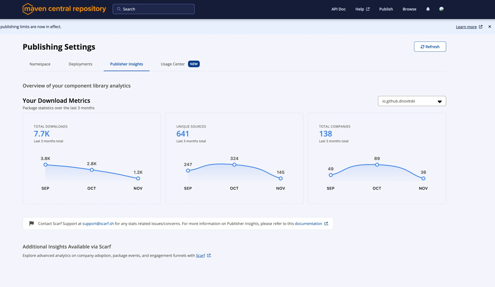

# io.github.dnovitski

Maven Central namespace of [@dnovitski](https://github.com/dnovitski).

## Published artifacts

| Artifact | Maven Central |
|----------|---------------|
| `logback-awslogs-appender` | [central.sonatype.com](https://central.sonatype.com/artifact/io.github.dnovitski/logback-awslogs-appender) |
| `logback-awslogs-appender-metrics-micrometer` | [central.sonatype.com](https://central.sonatype.com/artifact/io.github.dnovitski/logback-awslogs-appender-metrics-micrometer) |
| `lutung` | [central.sonatype.com](https://central.sonatype.com/artifact/io.github.dnovitski/lutung) |

## Download statistics

Sonatype Central Publisher Insights for the namespace, September to November 2026
(captured 2026-11-14): 7.7K downloads, 641 unique sources, 138 companies.

